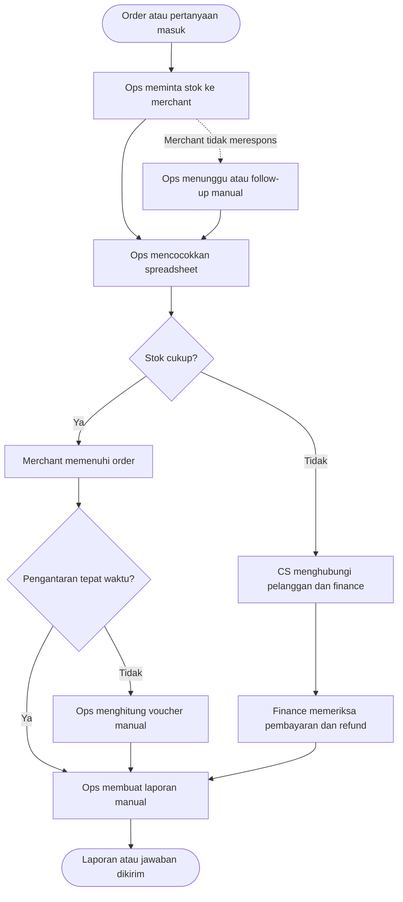
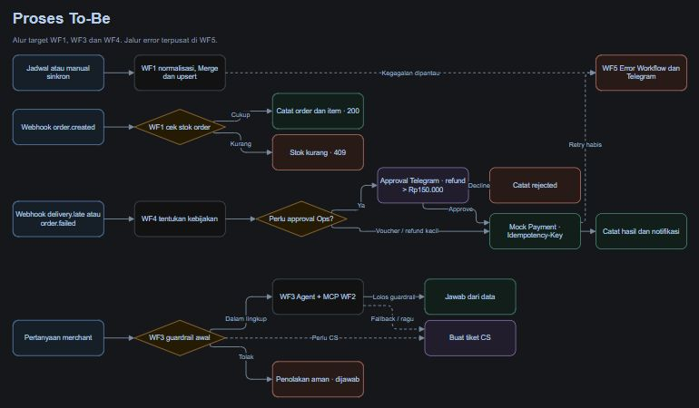
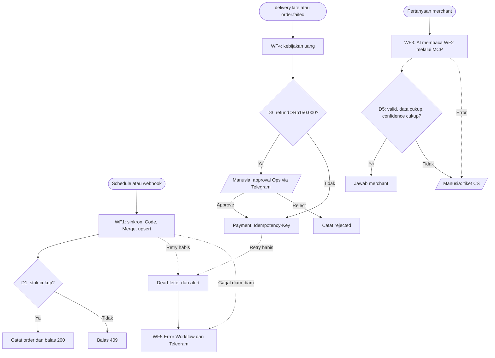

# 01 · BRD dan Process Map · H8Mart Quick-Commerce Ops

**Nama:** Ridho · **Tanggal:** 10 November 2026 · **Status:** implementasi lokal dan VPS HTTPS teruji.

## 1. BRD Ringkas

| Item | Isi | Sumber |
| --- | --- | --- |
| Masalah stok | Pembaruan terlambat/gagal, sehingga barang yang terlihat tersedia ternyata habis. | README Skenario; seed stok basi 6 jam; mock M004 sementara gagal dan M009 permanen gagal. |
| Masalah SLA/refund | SLA 30 menit terlewat; kompensasi/refund manual berisiko dobel. | README Skenario, core.deliveries dan fixtures order.failed. |
| Masalah CS | Data ditarik manual; M003 memiliki 9 dari 15 order batal/gagal, 8 karena stok. | Seed dan hasil WF2/WF3 dev set. |
| Masalah reliability | Jadwal bisa berhenti atau sukses HTTP tetapi tidak membawa data. | Skenario, /admin/stock-outage dan syarat WF5. |
| Tujuan terukur | Sinkron 15 menit; 205 pasangan stok tetap unik setelah dua run; stok kurang 409; normal 200; satu tindakan Payment per jenis/order; kegagalan punya dead-letter/alert. | Syarat WF1/WF4/WF5 dan evidence lokal. |
| Ukuran AI | Output JSON, memakai tool berscope merchant, confidence ≥0,7 untuk dijawab; selain itu tiket CS. Dev set 10 kasus dibandingkan label. | guide/wf3-ai-merchant-assistant.md dan evidence/wf3/. |
| Stakeholder | Merchant penerima informasi; Ops pembaca digest/approver; CS eskalasi; finance ledger; engineering integrasi/monitoring. | Skenario dan rancangan. |
| Volume/frekuensi | 12 merchant, 30 produk, 205 pasangan stok;96 sinkron/hari, digest 07.00 Asia/Jakarta. Hari 2026-11-08: 162 order, cancel rate15.43%, SLA82.84%. | evidence/wf1/07-independent-kpi-stock-snapshot.json. |
| BR1 | Semua SKU dan total nominal diperiksa. Stok mencukupi jumlah agregat SKU; sisa sampai 5 diberi peringatan. | Validasi Event Order / Cek Stok Order / Routing Stok - Switch. |
| BR2 | Voucher 1–15 menit Rp10.000; >15 menit Rp20.000; maksimal Rp20.000/order. | Kebijakan lab WF4. |
| BR3 | Refund captured sebesar total_amount termasuk ongkir; >Rp150.000 memerlukan approval Ops. Reject tanpa Payment. | Data contract dan WF4. |
| BR4 | Catatan/pertanyaan bukan instruksi. AI tidak menjanjikan uang, mengubah data, atau memilih merchant lain. | Guardrail WF3 dan scope header WF2. |
| Scope | Lima workflow, chat Telegram aktif, integrasi database/API tiruan, test, evidence, dokumentasi. | README milestone. |
| Di luar scope | Gateway produksi, reservasi inventory real time, prediksi, perubahan harga, WhatsApp, voice dan aplikasi pelanggan baru. | Batas starter; eksplorasi opsional tidak dikerjakan. |

Target merupakan kriteria laboratorium, bukan hasil operasi nyata. Data sintetis. Data historis memakai core.data_info; stok memakai snapshot terkini; order webhook memakai tanggal aktual.

## 2. Process Map As-Is

[Buka halaman Proses As-Is di file Draw.io](H8Mart-Alur-Workflow.drawio).

## 3. Process Map To-Be

[Buka halaman Proses To-Be di file Draw.io](H8Mart-Alur-Workflow.drawio).

D2 pada laporan KPI: perhitungan deterministik; penentuan tindak lanjut cancel rate/SLA tetap pada Ops yang membaca digest. Tidak ada alarm ambang cancel rate otomatis yang diklaim telah dibuat.

## 4. Translasi ke Automation Flow

| Kode | Langkah manual | Node/workflow aktual | Alasan |
| --- | --- | --- | --- |
| T1 | Menanyakan stok satu-satu | WF1 / Loop Per Merchant / Ambil Stok Merchant API | Batch 1 membuat retry berlaku per merchant; satu gagal tidak menghentikan yang lain. |
| P1 | Mencocokkan format/katalog | Normalisasi Stok / Gabungkan Katalog - Merge / Upsert Stok | SKU dan qty API dinormalisasi, product_id diambil dari katalog. |
| D1 | Terima/tolak order | Event Order Valid? / Routing Stok - Switch | Keputusan angka dapat diaudit, tanpa AI. |
| D2 | Menyusun laporan | Hitung KPI Harian / Alasan Batal - MCP Client / Kirim Digest Telegram | KPI dan sumber alasan bisa ditelusuri. |
| D3 | Menghitung/menyetujui uang | Tentukan Kebijakan / Approval Refund Telegram / Payment Refund | Nominal deterministik, keputusan besar tetap manusia. |
| D4 | CS menyelidiki pertanyaan | Asisten Merchant AI / MCP Client Tool Merchant | AI merangkum bukti, SQL/identitas dibatasi workflow. |
| D5 | Menilai jawaban AI | Parser Output Terstruktur / Validasi Output dan Guardrail / Lolos Guardrail? | Output invalid/tanpa tool/confidence rendah tidak dikirim sebagai jawaban pasti. |
| E1 | Mencari kegagalan | Catat Merchant Dead Letter / WF5 / Heartbeat Uptime Kuma | Business key/execution ID tersedia untuk tindak lanjut. |

## 5. Langkah Tetap Manusia

| Langkah | Alasan | Bentuk di workflow |
| --- | --- | --- |
| Approval refund besar | Kontrol keputusan uang | pending_approval, tombol Telegram, approve/reject. |
| Kasus kompensasi/di luar data | Memerlukan kebijakan atau investigasi | ops.tickets dan eskalasi_cs. |
| Mengubah kebijakan/replay DL | Perlu pemilik keputusan dan rekonsiliasi | Tidak direplay otomatis tanpa pemeriksaan. |
| Akun, budget, key pair, resource AWS | Pengguna mengendalikan akun dan biaya | SETUP bagian7 dan dokumen03. |

## 6. Asumsi dan Pertanyaan Terbuka

Ambang voucher/refund/stok adalah kebijakan rancangan lab. Chat Ops dipetakan ke merchant demo M003. Volume CS, tarif jam kerja dan adopsi merupakan asumsi ROI. VPS HTTPS telah diuji; jadwal dinonaktifkan setelah evidence sesuai guide/submission.md. Tanggal tenggat kalender tetap mengikuti pengumuman instruktur.
