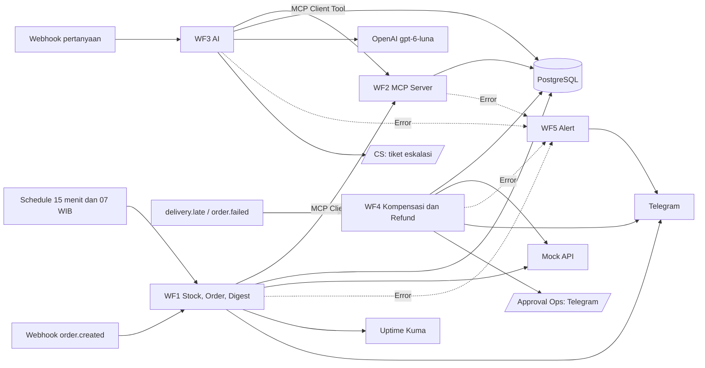

# 02 · Desain Solusi dan ROI · H8Mart Quick-Commerce Ops

**Nama:** Ridho · **Tanggal:** 10 November 2026

## 1. Arsitektur

[Buka halaman Arsitektur H8Mart dan diagram tiap workflow di file Draw.io](H8Mart-Alur-Workflow.drawio).

n8n/runner 2.44.7 sesuai starter. PostgreSQL hanya untuk H8Mart; metadata n8n memakai SQLite pada n8n_data. Host internal memakai nama service. WF3b aktif di VPS HTTPS; Telegram Trigger v1.5 mendukung pesan dan callback approval pada bot yang sama.

## 2. Keputusan Pendekatan

| Kode | Keputusan | Data | Pendekatan | Alasan |
| --- | --- | --- | --- | --- |
| D1 | Terima, tipis, atau tolak | SKU,qty,stok,harga | Rule-based | Agregasi SKU berulang dan validasi nominal termasuk ongkir dapat diaudit. |
| D2 | Menafsirkan cancel/SLA | Order/delivery hari data terakhir | Hitung rule-based; tindak lanjut Ops | Model tidak perlu menghitung persen. Tidak ada alarm cancel rate tambahan. |
| D3 | Voucher/refund/approval | Keterlambatan,payment_status,total_amount | Rule-based dan manusia | Voucher Rp10.000/Rp20.000; refund captured=total; >Rp150.000 ke Ops. |
| D4 | Menjelaskan masalah merchant | KPI,alasan,catatan,stok | AI melalui MCP | Bahasa fleksibel, data/merchant tetap dibatasi workflow. |
| D5 | Jawab atau eskalasi | Schema,confidence,panggilan tool,kewenangan | Rule-based dan CS | Confidence<0,7, tanpa tool, invalid, data kurang, atau janji uang menjadi tiket. |

Stok habis 0, menipis 1–5, cukup >5. Intake memperingatkan sisa ≤5. Tidak ada reservasi/pengurangan stok order, mengikuti model starter yang bersumber dari sinkron merchant.

## 3. ROI

Seluruh volume dan biaya tenaga berikut adalah asumsi perencanaan, bukan penghematan yang sudah dicapai.

| Komponen | Rumus/asumsi | Hasil |
| --- | --- | --- |
| Laporan Ops | 30 menit/hari ×30 hari |15 jam/bulan |
| Merchant CS |300/bulan; 60% selesai AI;6 menit manual−0,5 menit review |16,5 jam |
| Voucher/refund |200 kasus ×(4 menit manual−1 menit review/approval) /60 |10 jam |
| Total |15+16,5+10 |41,5 jam/bulan |
| Tenaga |Asumsi Rp60.000/jam |Penghematan kotor Rp2.490.000/bulan |
| LLM |10 kasus uji: 9.040 prompt-token estimate; proyeksi 300 kasus memakai rata-rata 904 input token/kasus dan 500 output token/kasus (asumsi) |US$0,10212 ≈Rp1.848/bulan (estimasi, bukan tagihan aktual) |
| Platform |Infrastruktur+backup/transfer budget+2 jam admin; dokumen 03 |Rp623.947/bulan |
| Net benefit |2.490.000−623.947−1.848 |**Rp1.864.205/bulan** (estimasi) |
| Investasi awal |12 jam implementasi+2 jam pelatihan ×Rp60.000 |Rp840.000 |
| Payback |840.000/net benefit |**0,45 bulan**, jika asumsi adopsi tercapai |

Perhitungan LLM menggunakan tarif Standard GPT-6 Luna yang saat ini tercantum di [halaman model resmi OpenAI](https://developers.openai.com/api/docs/models/gpt-6-luna) dan [halaman harga API](https://developers.openai.com/api/docs/pricing): input US$0,10/1 juta token dan output US$0,50/1 juta token. Trace sepuluh kasus uji mencatat 9.040 prompt-token estimate dan 0 completion token; kolom output pada trace tidak merekam usage provider, sehingga angka 0 bukan bukti tidak ada token keluaran/tagihan. Untuk proyeksi 300 kasus/bulan, input diproyeksikan dengan rata-rata trace 904 token per kasus (US$0,02712) dan output 500 token per kasus adalah asumsi anggaran (US$0,075). Total US$0,10212 ≈ Rp1.848 memakai kurs silang ECB yang dijelaskan dokumen 03. Ini estimasi berbasis trace dan asumsi output, bukan pemakaian/tagihan API aktual; periksa usage OpenAI untuk angka billing.

**Batas token:** trace 10 kasus mencatat 9040 prompt-token estimate melalui tokenUsageEstimate; completionTokens tercatat0. Itu bukan usage billing provider dan bukan output gratis. `evidence/wf3/05-tool-scope-token-audit.json` menyimpan fakta tersebut. Rata-rata 904 input token berasal dari estimate sepuluh kasus; 500 output token/kasus tetap asumsi anggaran. Perkiraan ini tidak menggantikan usage billing provider.

**Bukti spend aktual yang tersedia:** dashboard OpenAI Analytics menampilkan total **US$0,02 untuk 1–14 November 2026**. Tampilan memilih *Default project* dan *All API sources*, sehingga angka ini merupakan spend agregat pada cakupan tersebut; screenshot tidak membuktikan bahwa seluruh US$0,02 berasal dari H8Mart/WF3 atau hanya model GPT-6 Luna. Lihat [screenshot spend dashboard](../evidence/wf3/13-openai-api-spend-2026-11-01-to-14.png). Angka dashboard ini dicatat terpisah dari proyeksi 300 kasus di atas dan tidak dipakai untuk mengubah proyeksi bulanan.

Nominal refund bukan pemasukan/penghematan. Voucher dianggap sudah dianggarkan pada proses manual; tambahan penerima/nominal akibat automasi harus mengurangi net benefit. Risiko: adopsi/deflection lebih rendah, review lebih lama, kurs/biaya berubah, insiden menambah pekerjaan. Skenario terburuk tanpa adopsi: penghematan 0, biaya platform/LLM tetap ada dan payback tidak positif. Evaluasi volume/kebijakan sebelum menganggap ROI terealisasi.

## 4. Batas dan Risiko

| Risiko | Dampak | Mitigasi/batas aktual |
| --- | --- | --- |
| HTTP 200 stok kosong | Stok basi tampak sukses | Stop and Error, WF5, tanpa heartbeat; diuji. |
| Merchant permanen gagal | Merchant lain berhenti | Loop 1, retry 3, DL, lanjut; diuji. |
| Replay uang | Pembayaran dobel | Ledger unik dan Idempotency-Key sejak panggilan pertama; event/resume ulang diuji. |
| AI/tool gagal | Jawaban rekaan | Fallback→tiket CS→eskalasi_cs; key dummy diuji terpisah. |
| Injeksi/lintas merchant | Janji uang atau kebocoran | Scope dari workflow, SQL parameter, preguard, parser/postguard; dev set+audit. |
| Restart mock Payment | Idempotensi memori hilang | Ledger tetap; gateway produksi perlu idempotensi persisten dan rekonsiliasi. |
| Stok berubah/order paralel | Snapshot bukan reservasi | Reservasi persediaan produksi di luar scope. |
| Telegram terputus | Pesan tertunda/gagal | Jejak Notification dan error; pengiriman pesan bukan persetujuan, Telegram Send and Wait tetap memerlukan keputusan akun Ops yang diizinkan. |
