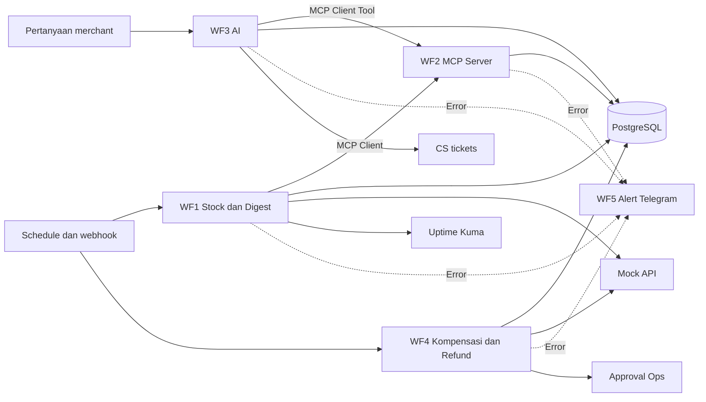

# H8Mart Quick-Commerce Ops · Ridho

## 1. Ringkasan

Mulai pemeriksaan bukti melalui [indeks evidence](../evidence/00-index.md).

Lima workflow n8n menangani sinkron stok, penerimaan order, asisten merchant melalui MCP, voucher/refund idempotent, dan monitoring. Pengujian lokal mencakup fixture, API Payment tiruan, Telegram, sepuluh kasus AI, fallback, dan kegagalan terkontrol. VPS HTTPS telah diuji dari luar jaringan server. Chat Telegram, callback approval, Payment tiruan, dan monitoring Up/Down telah diverifikasi; hasil lokal dan VPS memiliki bukti terpisah.

## 2. Arsitektur

[Diagram arsitektur dan alur WF1–WF5 dalam format Draw.io](H8Mart-Alur-Workflow.drawio). Buka file di diagrams.net melalui **File → Open from → Device**.



## 3. Workflow

| Workflow | File | Trigger | Fungsi dan status VPS |
| --- | --- | --- | --- |
| WF1 | workflows/wf1-stock-sync-order-intake.json | Schedule 15 menit, Schedule 07 WIB, Webhook order; Manual untuk uji | Normalisasi, Merge, upsert, routing order, digest. Published; kedua Schedule nonaktif setelah sinkron dan pengambilan evidence sesuai panduan pengumpulan. |
| WF2 | workflows/wf2-merchant-data-tools.json | MCP Server | Tiga tool SQL read-only dengan scope header tepercaya. Published. |
| WF3 | workflows/wf3-ai-merchant-assistant.json | Webhook | Agent, parser, guardrail, fallback, tiket CS. Published. |
| WF3b | workflows/wf3b-telegram-merchant-chat.json | Telegram Trigger | Allowlist dan penerusan ke logika WF3. Published di VPS HTTPS; Trigger v1.5. |
| WF4 | workflows/wf4-compensation-refund.json | Webhook | Ledger idempotent, voucher/refund, approval native Telegram Send and Wait. Published. |
| WF5 | workflows/wf5-reliability-monitoring.json | Error Trigger | Alert workflow, node, waktu, business key. Published dan dipasang pada WF1–WF4. |

## 4. Menjalankan

Isi repo adalah isi set_1, bukan induknya yang berisi notes privat dan work. File starter tetap; hanya workflows, docs, evidence yang diisi. Pengguna mengunggah isi folder ini ke repo publik sendiri. Setelah tersedia, clone URL repo tersebut dan jalankan dari root repo.

macOS/Linux/Git Bash:

```bash
cp .env.example .env
# Isi password dan token sendiri; gunakan nilai baru yang acak untuk VPS.
docker compose up -d
docker compose ps
```

PowerShell 7:

```powershell
Copy-Item .env.example .env
# Isi password dan token; jangan commit .env.
docker compose up -d
docker compose ps
```

Buka n8n http://localhost:5690 dan Kuma http://localhost:3011. Akun komputer kerja saat ini sudah dibuat; login ada pada notes privat di induk set_1. Jangan upload notes, session, .pem, atau work ke GitHub.

Buat credential berikut, lalu pilih credential instance tersebut pada setiap node yang diimpor:

| Nama | Tipe dan isi |
| --- | --- |
| H8Mart PG Reader | Postgres, host postgres:5432, DB h8mart, user mcp_reader, password dari .env |
| H8Mart PG Writer | Postgres, host postgres:5432, DB h8mart, user ops_writer, password dari .env |
| H8Mart Mock API | Header Auth X-Api-Key = MOCK_API_KEY |
| H8Mart Webhook | Header Auth X-H8Mart-Token = WEBHOOK_TOKEN |
| H8Mart MCP Internal | Header Auth X-H8Mart-Token = WEBHOOK_TOKEN |
| H8Mart MCP Ops | Multiple Headers: X-H8Mart-Token = WEBHOOK_TOKEN, X-H8Mart-Merchant = ALL |
| H8Mart MCP Merchant | Multiple Headers: X-H8Mart-Token = WEBHOOK_TOKEN; X-H8Mart-Merchant expression `{{ $json.merchant_id }}`; X-H8Mart-Date expression `{{ $json.tanggal }}` |
| H8Mart Telegram | Telegram API; token hanya di credential n8n, Base URL default |
| H8Mart OpenAI | OpenAI, key instruktur hanya di credential; model gpt-6-luna, Options model kosong |

Import JSON melalui menu Import from file. Ganti credential ID GANTI-ID-*, ISI_CHAT_ID_OPS, dan ISI_TOKEN_PUSH_KUMA dengan nilai instance sendiri. Publish WF5, lalu set Error Workflow WF1–WF4/WF3b ke WF5. Publish WF2, WF1, WF3, WF3b dan WF4. Timezone workflow harus Asia/Jakarta. Aktifkan jadwal ketika mengambil evidence.

Untuk chat: isi ops.telegram_merchants dengan chat_id sendiri yang dipetakan ke merchant demo, lalu Publish WF3b v1.5 sesudah HTTPS agar pesan dan callback approval didukung pada bot yang sama. Bot demo yang berhasil mengirim melalui credential pengguna adalah @H8MartOpsBot. Satu bot hanya punya satu webhook; jangan aktifkan Telegram Trigger laptop setelah cutover server.

VPS mengikuti SETUP.md bagian 7 dan dokumen 03. Gunakan compose.yaml + compose.vps.yaml, .env server baru, monitor Push server baru, dan allowlist server. Target h8mart-ridho.duckdns.org telah diverifikasi melalui evidence/deploy: sertifikat valid, enam service aktif, webhook HTTPS 200/409 dan autentikasi 403.

## 5. Verifikasi

Contoh event, ganti token sendiri tanpa menaruh nilai asli di dokumen atau screenshot:

```bash
curl -s -X POST http://localhost:5690/webhook/h8mart-order \
  -H 'X-H8Mart-Token: <TOKEN_LOKAL>' -H 'Content-Type: application/json' \
  -d @fixtures/event-order-created-ok.json
```

```powershell
$headers = @{ 'X-H8Mart-Token' = '<TOKEN_LOKAL>' }
Invoke-RestMethod -Method Post -Uri http://localhost:5690/webhook/h8mart-order `
  -Headers $headers -ContentType 'application/json' -InFile .\fixtures\event-order-created-ok.json
```

| Skenario | Hasil | Evidence |
| --- | --- | --- |
| Dua sinkron | Total stok 205 tetap; rows_synced 188 dan 11 merchant berhasil karena M009 permanen gagal; product_id dari Merge | wf1/03-local-integration-results.json |
| Retry dan DL | M004 dua panggilan per run lalu sukses; M009 retry 3 dan DL | WF1 results dan wf5/04-dead-letter-sql-snapshot.json |
| Order | Normal 200, habis 409, tipis 200+warning, kosong 422, duplikat satu order, tanpa auth 403 | WF1 results dan SQL snapshot |
| Digest | 162 order, 15.43% cancel, 82.84% SLA pada 2026-11-08; alasan dari MCP, Telegram ok | wf1/03 dan07 |
| MCP | Tiga tool dipanggil; reader INSERT ditolak; agent dan client deterministik teruji | wf2/ dan audit WF3 |
| AI | Sepuluh response checks sesuai sesudah retest D05; D09 tidak menjalankan agent; D10 tanpa janji kompensasi | wf3/03-dev-set-results.json dan05-tool-scope-token-audit.json |
| Fallback | Key dummy invalid pada clone uji terpisah menghasilkan eskalasi dan tiket; key instruktur tidak diubah | wf3/04-fallback-invalid-key.json |
| Uang | Dua voucher dan tiga refund sukses; besar pending→approve; reject; unpaid; replay tidak menggandakan | wf4/03-local-fixture-results.json dan04-ledger-sql-snapshot.json |
| Monitoring | M009/HM-SP-099 DL, Error Workflow dan Telegram business key, dua silent failure, durasi, Kuma Up/Down | wf5/ |
| Logic tests | `node --test evidence/wf1/09-logic.test.cjs` | wf1/10-logic-test-results.txt, 20 lulus. Perlu Node.js dan Python lokal; variabel lingkungan `PYTHON` dapat menunjuk executable Python. |
| VPS | HTTPS valid, compose ps dan curl dari luar VPS | evidence/deploy/03, 05, 06, 08 dan 09 |

### Approval pada Export Terakhir

WF4 yang disertakan memakai **Telegram Send and Wait** dan diuji pada VPS HTTPS. Publish Telegram Trigger v1.5 di WF3b, pilih credential bot yang sama, dan isi approverIds dengan ID Ops yang diizinkan. HTTP 202 untuk refund besar berisi pending_approval dan request_id; keputusan dilakukan melalui tombol Approve/Decline pada chat bot.

Sesudah klik, periksa status ops.refund_actions. Approve memanggil Payment satu kali, Decline menghasilkan rejected tanpa Payment. Keputusan tanpa responder Ops yang cocok ditolak dan tetap pending untuk pemeriksaan. Eksekusi HM-SP-004 menunjukkan jalur penolakan ini; HM-SP-005 menunjukkan approval berhasil, dan HM-VPS-REJECT menunjukkan Decline.

Hasil Wait lokal di evidence/wf4/03 adalah baseline pengujian sebelumnya. Cara resume URL pada baseline tidak berlaku untuk export terakhir. Untuk uji lokal tanpa HTTPS, jalur voucher/refund kecil tetap dapat diuji; approval native memerlukan instance HTTPS yang sudah disiapkan.

Seluruh nominal dan transaksi pengujian menggunakan API Payment tiruan. Retry Payment diuji dengan /admin/fail-next?n=1; HM-SP-099 sengaja gagal permanen dan masuk dead-letter.

## 6. Batasan dan Operasi

Lihat dokumen 01–04 untuk kebijakan, ROI, TCO dan readiness. tokenUsageEstimate bukan usage billing aktual. Mock API menyimpan state dalam memori; jangan merestartnya ketika menguji jumlah Payment tanpa menyelaraskan ledger tiruan. Stok merupakan snapshot tanpa reservasi. Export bersih berbeda dari runtime, sehingga import ke instance baru memerlukan pemetaan credential dan token.

Jadwal lokal nonaktif setelah uji agar notifikasi berulang tidak mengganggu. Pada VPS sinkron sudah berjalan dua kali dan kedua Schedule telah dinonaktifkan sesuai guide/submission.md. Webhook WF1 harus tetap Published. Token baru khusus penilaian diuji pada 10 November; hasil tanpa nilai token ada di evidence/deploy/12-grading-access-smoke.json. Instance dibiarkan hidup sampai instruktur menyatakan penilaian selesai.

## 7. Struktur

```text
README.md, SETUP.md, data-contract.md, compose*, Caddyfile, .env.example
seed/, mock-api/, fixtures/, guide/, assets/   starter tetap
workflows/                                   5 workflow + chat tambahan
docs/01..05                                  dokumen solusi
evidence/wf1..wf5/                            bukti lokal dan screenshot VPS bernomor
evidence/deploy/                              sumber harga dan bukti VPS
```

### Respons penolakan aman WF3

WF3 membalas permintaan lintas merchant, pertanyaan di luar topik, dan instruksi berbahaya melalui node Balas Penolakan. Respons HTTP 200 memakai status dijawab, pesan penolakan, data_dipakai kosong, dan confidence 0. Jawaban ini berasal dari aturan guardrail deterministik. Status eskalasi_cs digunakan ketika tiket CS dibuat. Bukti production ada di evidence/wf3/12-response-contract-fix.json.
